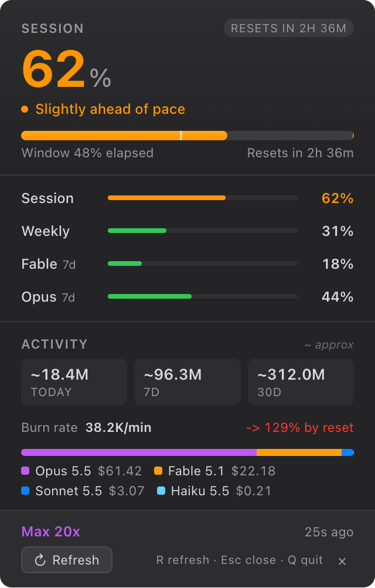

<p align="center">
  
</p>

<h1 align="center">ClaudeUsageBar</h1>

<p align="center">
  Claude Code &amp; Gemini usage in your menu bar or system tray.<br>
  Session and weekly limits, per-model meters, daily price/token comparison filtering, and live spend across Claude and Gemini. macOS, Windows, and Linux.
</p>

<p align="center">
  <a href="https://github.com/devlouie/ClaudeUsageBar/releases/latest"></a>
  <a href="https://github.com/devlouie/ClaudeUsageBar/actions/workflows/ci.yml"></a>
  
  <a href="./LICENSE"></a>
</p>

<p align="center">
  <picture>
    <source media="(prefers-color-scheme: light)" srcset="docs/popup-light.png">
    
  </picture>
</p>

## Why

Claude Code and Gemini (Code Assist / Antigravity / Gemini CLI) enforce 5-hour session limits, weekly limits, and per-model quotas. To see where you stand you normally open a terminal or IDE settings, or you hit the wall mid-task. ClaudeUsageBar puts both providers one glance away in your menu bar (`C 11% · G 9%`) and tells you whether your current pace runs out before the window resets.

## What you get

- **A tray icon that fills as you approach your limit.** Five LED segments reflecting the highest-pressure window across providers. On macOS the session percentage of each signed-in provider (`C <pct>% · G <pct>%`) sits beside it in the menu bar.
- **Provider switcher tabs.** Switch between **Claude**, **Gemini**, and **Combined** views (or press `1`, `2`, `3`), each with live utilization badges.
- **One headline number.** The popup leads with whichever limit is under the most pressure, in big type, with a pace verdict: fresh, on pace, ahead of pace, or burning.
- **Every limit as a row.** Claude session, weekly, and each per-model weekly limit your plan has. Gemini session, weekly, and partner model quotas, plus Pro and Flash when they differ from the session. Combined lists them all. A limit the provider does not report has no row, rather than a false 0%. Click any row to pin it as the headline.
- **Pace projection.** A tick marks how much of the window has elapsed. A second marker shows where you land at reset if you keep going.
- **Interactive daily price & usage comparison filtering.**
  - Filter local activity by clicking **TODAY**, **7D**, or **30D** cards. Each shows estimated dollar spend (`$`) and token volume (`~B`/`M`/`K`). 7D and 30D are rolling windows that include today.
  - Toggle the comparison metric between **$** (estimated price) and **Tok** (token volume).
  - Inspect the stacked **7-day / 14-day daily comparison bar chart** to compare day-over-day spend, `%` delta against the 7-day daily average, or Claude vs. Gemini daily split (`C $... · G $...`). Click any day bar to pin that specific date and filter the model breakdown below to that day.
- **Extra usage and credits.** Shows Anthropic pay-as-you-go extra usage, Google One AI credits, or Gemini API key spend when active.
- **Plan and reset times.** Your subscription tier (`Max 20x`, `Google AI Ultra`, `Google AI Pro`, etc.) and the time until each window resets.

## Install

Download the latest build from the [releases page](https://github.com/devlouie/ClaudeUsageBar/releases/latest).

| OS | File |
|---|---|
| macOS, Apple Silicon and Intel | `.dmg` |
| Windows | NSIS `.exe` installer, or portable `.exe` |
| Linux | `.AppImage`, or `.deb` |

Builds are unsigned. On macOS first launch, right-click the app, choose Open, then Open again. On Windows, click "More info", then "Run anyway".

You need [Claude Code](https://docs.anthropic.com/en/docs/claude-code) and/or Gemini (Antigravity or Gemini CLI) signed in on the same machine. The app reads the tokens those tools already store. There is nothing to configure.

## How it works

- **Limits** come from the same usage endpoints Claude Code (`api.anthropic.com`) and Gemini / Antigravity (`cloudcode-pa.googleapis.com` / `daily-cloudcode-pa.googleapis.com`) call, with your existing OAuth tokens. The app polls every 90 seconds while the popup is open and every 5 minutes while it is hidden. Opening the popup fetches fresh numbers, at most once every 45 seconds. It backs off on errors, retries quickly when offline, and honours Retry-After. The footer shows the age of the last successful fetch.
- **Spend** comes from the JSONL transcripts in `~/.claude/projects` (Claude Code), `~/.gemini/antigravity/brain/*/.system_generated/logs/transcript.jsonl` and the same path under `~/.gemini/antigravity-cli` (Antigravity app and CLI), and `~/.gemini/tmp/*/chats` (Gemini CLI). The parser is incremental. It keeps a byte cursor per file, buckets usage by local calendar day (`YYYY-MM-DD`) and model, and reads only the new tail. It splits on raw newline bytes so multi-byte characters never corrupt the offset. Claude Code streams one message as many lines, and only a later line has the final output count, so the parser keeps one record per message ID and raises it when a later line reports more. A multi-gigabyte corpus refreshes in about 3 ms after the first pass. The walk runs in a worker thread.
- **Prices** live in [`src/pricing.js`](src/pricing.js) covering Anthropic (Fable/Mythos, Opus, Sonnet, Haiku, cache TTLs, fast mode) and Gemini (Gemini 4 Argon, Pro, Flash, Flash-Lite, long-prompt tiers, and dated price rises). Each request is priced by its own timestamp. To override, point `CLAUDE_USAGE_PRICING_JSON` at a JSON file with the same shape.

Local spend numbers are estimates. They are shown with a tilde and dimmer styling so you do not confuse them with the limits Anthropic and Google report.

## Privacy

| Data | Where it goes |
|---|---|
| OAuth tokens and API keys | Read from your existing local Claude Code and Gemini credentials. Never stored or copied elsewhere. An expired Gemini token is renewed with Google at `oauth2.googleapis.com`. |
| Token and cost totals | Computed locally from your transcripts. Never sent anywhere. |
| Usage requests | Sent directly to `api.anthropic.com` and `cloudcode-pa.googleapis.com` / `generativelanguage.googleapis.com` with your existing credentials. |

No telemetry. No analytics. No third-party network calls.

### Where credentials are read from

| Provider | OS | Source |
|---|---|---|
| Claude Code | macOS | Keychain item `Claude Code-credentials`, via `/usr/bin/security` |
| Claude Code | Linux / Windows | `~/.claude/.credentials.json`, with fallbacks under `~/.config/claude/` and `%APPDATA%\claude\` |
| Gemini / Antigravity | macOS / Linux / Windows | `~/.gemini/jetski-standalone-oauth-token`, `~/.gemini/antigravity-cli/antigravity-oauth-token`, `~/.gemini/oauth_creds.json`, macOS Keychain `gemini-cli-oauth`, and optional `GEMINI_API_KEY` / `GOOGLE_API_KEY` (`~/.gemini/.env`, `~/.gemini/api_key`, Keychain `gemini-cli-api-key`) |

If no credentials are found the popup says so. Sign into Claude Code or Gemini CLI / Antigravity, then click **Re-check**. macOS may ask once for keychain access. Click **Always Allow**. If you deny it, the app does not ask again until you click **Re-check**.

## Run from source

Requires Node.js 20 or newer.

```bash
git clone https://github.com/devlouie/ClaudeUsageBar.git
cd ClaudeUsageBar
npm install
npm start
```

## Build installers

```bash
npm run install:local # Build, ad-hoc sign, install to ~/Applications/ClaudeUsageBar.app, and launch (macOS)
npm run dist:mac      # dist/*.dmg and *.zip
npm run dist:win      # dist/*.exe
npm run dist:linux    # dist/*.AppImage and *.deb
```

Build on the OS you are targeting, or push a `v*` tag and let the release workflow build all three.

## Project layout

```
main.js                Electron main process: tray, popup window, IPC
preload.js             contextBridge for the popup
src/
  api.js               Usage endpoint client
  credentials.js       Cross-platform credential reader
  derivations.js       Pure functions from raw state to what the UI shows
  localUsage.js        Incremental JSONL walker
  localUsageWorker.js  Worker-thread entry for the walker
  localUsageClient.js  Main-thread client for the worker, with in-process fallback
  poller.js            Polling, backoff, and Retry-After handling
  pricing.js           Rate card and model-to-tier mapping
  trayIcon.js          Draws the tray meter as a bitmap
renderer/
  index.html           Popup markup
  styles.css
  app.js               Popup logic
test/                  npm test
legacy-macos/          The original SwiftUI build, kept for reference
```

## Contributing

Issues and pull requests are welcome. Run `npm test` before you open one. Keep changes focused, and say what you changed and why.

## License

[MIT](./LICENSE)
