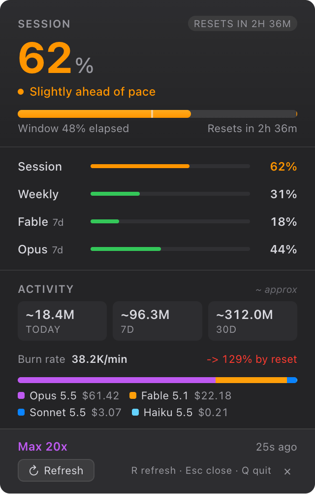

<p align="center">
  
</p>

<h1 align="center">ClaudeUsageBar</h1>

<p align="center">
  Claude Code usage in your menu bar or system tray.<br>
  Session and weekly limits, per-model meters, and live token spend. macOS, Windows, and Linux.
</p>

<p align="center">
  <a href="https://github.com/devlouie/ClaudeUsageBar/releases/latest"></a>
  <a href="https://github.com/devlouie/ClaudeUsageBar/actions/workflows/ci.yml"></a>
  
  <a href="./LICENSE"></a>
</p>

<p align="center">
  <picture>
    <source media="(prefers-color-scheme: light)" srcset="docs/popup-light.png">
    
  </picture>
</p>

## Why

Claude Code has a 5-hour session limit and a weekly limit. Some models carry their own weekly meter on top. To see where you stand you open a terminal and type `/usage`, or you hit the wall mid-task. ClaudeUsageBar puts the numbers one glance away and tells you whether your current pace runs out before the window resets.

## What you get

- **A tray icon that fills as you approach your limit.** Five LED segments. On macOS the percentage sits beside it in the menu bar.
- **One headline number.** The popup leads with whichever limit is under the most pressure, in big type, with a pace verdict: fresh, on pace, fast, or burning.
- **Every limit as a row.** Session, weekly, and per-model weekly meters such as Fable and Opus. Click a row to pin it as the headline.
- **Pace projection.** A tick marks how much of the window has elapsed. A second marker shows where you land at reset if you keep going.
- **Live token spend.** Today, 7 days, and 30 days, parsed from your local Claude Code transcripts. A burn rate in tokens per minute. A stacked bar of spend by model, priced from the current Anthropic rate card.
- **Extra usage.** If pay-as-you-go extra usage is on, the popup shows credits used against the monthly cap.
- **Plan and reset times.** Your plan tier and the time until each window resets.

## Install

Download the latest build from the [releases page](https://github.com/devlouie/ClaudeUsageBar/releases/latest).

| OS | File |
|---|---|
| macOS, Apple Silicon and Intel | `.dmg` |
| Windows | NSIS `.exe` installer, or portable `.exe` |
| Linux | `.AppImage`, or `.deb` |

Builds are unsigned. On macOS first launch, right-click the app, choose Open, then Open again. On Windows, click "More info", then "Run anyway".

You need [Claude Code](https://docs.anthropic.com/en/docs/claude-code) signed in on the same machine. The app reads the token Claude Code already stores. There is nothing to configure.

## How it works

- **Limits** come from the same usage endpoint Claude Code calls, with your existing token. The app polls every 90 seconds while the popup is open and every 5 minutes while it is hidden. It backs off on errors and honours Retry-After.
- **Spend** comes from the JSONL transcripts in `~/.claude/projects`. The parser is incremental. It keeps a byte cursor per file and reads only the new tail. It splits on raw newline bytes so multi-byte characters never corrupt the offset. It de-duplicates messages that Claude Code re-emits under several parent chains. A 300 MB corpus refreshes in about 2 ms after the first pass. The walk runs in a worker thread.
- **Prices** live in [`src/pricing.js`](src/pricing.js) with the date they were last checked against the [Anthropic price list](https://platform.claude.com/docs/en/about-claude/pricing). The table covers cache reads, 5-minute and 1-hour cache writes, the Haiku 5.5 prompt-length tiers, and Opus fast mode. To override, point `CLAUDE_USAGE_PRICING_JSON` at a JSON file with the same shape.

Local spend numbers are estimates. They are shown with a tilde and dimmer styling so you do not confuse them with the limits Anthropic reports.

## Privacy

| Data | Where it goes |
|---|---|
| OAuth token | Read from your existing Claude Code credentials. Never copied off your machine. |
| Token and cost totals | Computed locally from your transcripts. Never sent anywhere. |
| Usage request | Sent to `api.anthropic.com` with your existing token. It is the same call Claude Code makes. |

No telemetry. No analytics. No third-party network calls.

### Where credentials are read from

| OS | Source |
|---|---|
| macOS | Keychain item `Claude Code-credentials`, via `/usr/bin/security` |
| Linux | `~/.claude/.credentials.json`, with fallbacks under `~/.config/claude/` |
| Windows | `%USERPROFILE%\.claude\.credentials.json`, with fallbacks under `%APPDATA%\claude\` |

If no credentials are found the popup says so. Sign into Claude Code, then click **Re-check**. macOS may ask once for keychain access. Click **Always Allow**.

## Run from source

Requires Node.js 20 or newer.

```bash
git clone https://github.com/devlouie/ClaudeUsageBar.git
cd ClaudeUsageBar
npm install
npm start
```

## Build installers

```bash
npm run dist:mac     # dist/*.dmg and *.zip
npm run dist:win     # dist/*.exe
npm run dist:linux   # dist/*.AppImage and *.deb
```

Build on the OS you are targeting, or push a `v*` tag and let the release workflow build all three.

## Project layout

```
main.js                Electron main process: tray, popup window, IPC
preload.js             contextBridge for the popup
src/
  api.js               Usage endpoint client
  credentials.js       Cross-platform credential reader
  derivations.js       Pure functions from raw state to what the UI shows
  localUsage.js        Incremental JSONL walker
  localUsageWorker.js  Worker-thread entry for the walker
  localUsageClient.js  Main-thread client for the worker, with in-process fallback
  poller.js            Polling, backoff, and Retry-After handling
  pricing.js           Rate card and model-to-tier mapping
renderer/
  index.html           Popup markup
  styles.css
  app.js               Popup logic
  icon.html            Off-screen canvas that draws the tray icon
test/                  node test/localUsage.test.js
legacy-macos/          The original SwiftUI build, kept for reference
```

## Contributing

Issues and pull requests are welcome. Run `npm test` before you open one. Keep changes focused, and say what you changed and why.

## License

[MIT](./LICENSE)
